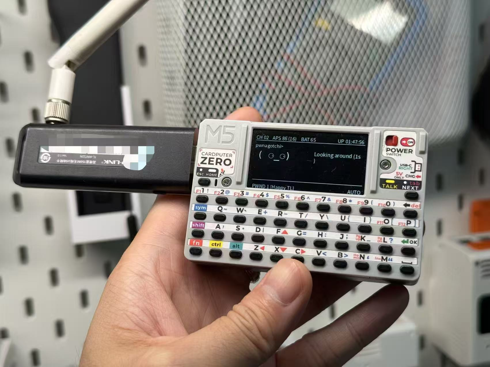

# cardputer-pwnagotchi

> [!IMPORTANT]
> The CardputerZero CM0 onboard Wi-Fi does **not** support monitor mode and
> cannot be used for Pwnagotchi packet capture. This app requires an external
> USB Wi-Fi adapter that supports monitor mode.
>
> Tested hardware: **TP-Link TL-WN722N v1.0** USB Wi-Fi adapter
> (Atheros AR9271 chipset).



Pwnagotchi APPLaunch client for CardputerZero, implemented in the same style as `cardputer-xiaozhi`:
- C++ app loop for input and page state
- Python bridge for local `pwnagotchi` / `bettercap` aggregation
- Python framebuffer renderer for small-screen UI

## Features

- Three native pages: `Home`, `Stats`, `Control`
- Local status aggregation from:
  - `systemd` service state
  - `bettercap` REST session endpoint
  - `config.toml`
  - handshake directory counts
- Read-only dashboard behavior: service and mode changes are deliberately left
  to the host administrator so the App Store package never mutates system
  services or configuration.
- APPLaunch `.deb` packaging

## Hardware requirement

CardputerZero's CM0 Wi-Fi can stay available for normal network access, but it
is not usable as the Pwnagotchi capture interface because it cannot enter
monitor mode. A separate monitor-mode capable USB Wi-Fi adapter is required.

The tested setup uses:

- USB Wi-Fi: TP-Link TL-WN722N v1.0 (Atheros AR9271 chipset)
- Default source interface selection: `auto`
- Monitor interface created by the installer/wrapper: `${source}mon`, for example `wlan1mon`

The runtime configuration lives in `/etc/default/pwnagotchi-cardputer`:

```bash
PWNAGOTCHI_SOURCE_IFACE=auto
PWNAGOTCHI_IFACE=auto
PWNAGOTCHI_MODE=auto
PWNAGOTCHI_HANDSHAKES_FILE=/home/pi/handshakes/bettercap-wifi-handshakes.pcap
```

The App Store package does not create interfaces or alter system services. The
host administrator is responsible for configuring the external adapter and
the existing Pwnagotchi/bettercap installation. The dashboard only observes
their state.

## Build

Stub build:

```bash
bash ./build.sh
```

Simulator build:

```bash
bash ./build.sh --sim
```

Device build:

```bash
bash ./build.sh --device
```

Package build:

```bash
bash ./build.sh --aarch64 --package
```

The release package is intended to be built on a Linux arm64 GitHub Actions
runner:

```bash
gh workflow run build-deb.yml
```

The generated `.deb` contains only the APPLaunch UI, bridge scripts, icon, and
desktop entry. It has no maintainer scripts and performs no install-time
network access, pip installation, systemd changes, caplet edits, or writes to
`/usr/local`. Fonts come from declared Debian dependencies.

Tagged pushes (`v*`) attach the `.deb` to the GitHub release. Pushes to `main`
or `ci/**` publish a prerelease artifact for testing.

## App Store publishing

This repository includes CardputerZero App Store metadata in
[app-builder.json](/Users/jdaie/repositories/m5stack/cardputer-pwnagotchi/app-builder.json).
The store description explicitly calls out the CM0 monitor-mode limitation and
the external USB Wi-Fi requirement.

Recommended publish flow:

```bash
gh workflow run build-deb.yml
gh release download <release-tag> --pattern 'cardputerzero-pwnagotchi_*_arm64.deb' --dir build
czdev login
czdev publish --deb build/cardputerzero-pwnagotchi_0.1.2-m5stack1_arm64.deb
```

## Environment

See [.env.template](/Users/jdaie/repositories/m5stack/cardputer-pwnagotchi/.env.template).

Supported variables:
- `PWNAGOTCHI_CONFIG`
- `PWNAGOTCHI_HANDSHAKES_DIR`
- `PWNAGOTCHI_SERVICE_NAME`
- `BETTERCAP_API_URL`
- `BETTERCAP_USERNAME`
- `BETTERCAP_PASSWORD`

## Runtime layout

- [main/src/application.cpp](/Users/jdaie/repositories/m5stack/cardputer-pwnagotchi/main/src/application.cpp)
  Page state machine and input handling
- [main/src/pwnagotchi_client.cpp](/Users/jdaie/repositories/m5stack/cardputer-pwnagotchi/main/src/pwnagotchi_client.cpp)
  C++ to Python bridge transport
- [main/tools/pwnagotchi_bridge.py](/Users/jdaie/repositories/m5stack/cardputer-pwnagotchi/main/tools/pwnagotchi_bridge.py)
  Local aggregation and service control
- [main/tools/display_bridge.py](/Users/jdaie/repositories/m5stack/cardputer-pwnagotchi/main/tools/display_bridge.py)
  Framebuffer rendering

## Host integration

This package is intentionally read-only. Install and configure Pwnagotchi,
bettercap, the monitor-mode interface, and any service permissions separately
as an administrator. Control-page actions return an explanatory message rather
than changing the host.

## License

This project is released under the [MIT License](LICENSE).
